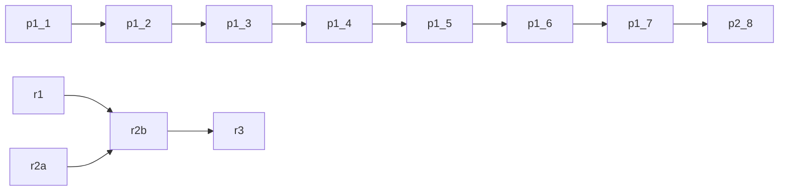

# Build plan (generated by tools/queue.py; edit build_queue.json)

Agents: run `python3 tools/queue.py next`, build it, then `python3 tools/queue.py done <id>`,
commit, push to `consistency-pass`. `[ ]` pending, `[x]` done, `[!]` waiting on Sir.

## Dependencies

## People unification
- [ ] `p1.1` Fold mall offset into mallWalkerAt return; drop m.oa/m.ob at 3 call sites [docs/people-unification.md#plan-by-risk]
- [ ] `p1.2` One loopWalkStep for ballroom + derby walkers (identical positions) [docs/people-unification.md]
- [ ] `p1.3` One pathAt replacing mallStaffAt + hospWalkerAt [docs/people-unification.md]
- [ ] `p1.4` One talkRun for ballroom/derby chatter (visible change) [docs/people-unification.md]
- [ ] `p1.5` EXCUSE table + excuseSay (hospital visible change) [docs/people-unification.md]
- [ ] `p1.6` Looks through partyLook, old generators as aliases [docs/people-unification.md]
- [ ] `p1.7` Derby onto scene.time.now [docs/people-unification.md]
- [ ] `p2.8` PEOPLE registry (updateKnocks, blockAt, hospital walkers solid) [docs/people-unification.md]

## Roadmap: routes, ramps, editor
- [ ] `r1` Dev challenge routes data plumbing [docs/roadmap.md#phase-1]
- [ ] `r2a` Ramp/kicker lab bench, all 4 headings [docs/ramp-jump-spec.md]
- [ ] `r2b` Port ramp/kicker + ring of fire into game/index.html, debut in a challenge route [docs/ramp-jump-spec.md]
- [ ] `r3` Community route editor [docs/roadmap.md#phase-3]

## Specs (waiting on decisions)
- [!] `s1` Onboarding level 'Learn the Ropes' (needs hazard choice, menu label) [docs/onboarding-spec.md]
- [!] `s2` Skins redemption-code model (needs price, launch count, code format) [docs/skins-spec.md]
- [!] `s3` Keepsakes data shape + story 'Fourth Place' (needs save-across-devices, mission data) [docs/keepsakes.md]

## Wishlist
- [ ] `w1` robot.axle + robot.battery into game build [docs/ASSETS.md#known-gaps--wishlist]
- [ ] `w2` Building fronts behind the sidewalk [docs/ASSETS.md#known-gaps--wishlist]
- [ ] `w3` Wandering dog (prop.dog static) [docs/ASSETS.md#known-gaps--wishlist]

## Consistency pass: doors
- [ ] `d1` Working door: Seabreeze Ballroom (doorF records itself) [docs/state/CONSISTENCY_PASS.md#still-to-do]
- [ ] `d2` Working door: Animal Shelter (painted door today) [docs/state/CONSISTENCY_PASS.md#still-to-do]
- [ ] `d3` Working door: harbour boat cabin [docs/state/CONSISTENCY_PASS.md#still-to-do]
- [ ] `d4` Working doors: Surfside Diner + Sandpiper Shoes [docs/state/CONSISTENCY_PASS.md#still-to-do]
- [ ] `d5` Kai + surf stand door; Low Tide Music door faces away [docs/state/CONSISTENCY_PASS.md#still-to-do]

## Consistency pass: buildings
- [ ] `b1` Tide Pool Elementary in pieces (U1k/U1c) [docs/state/CONSISTENCY_PASS.md#still-to-do]
- [ ] `b2` Palmline Tower key + vol, forecourt out of its one image [docs/state/CONSISTENCY_PASS.md#still-to-do]

## Consistency pass: vehicles
- [ ] `v1` One vehicleSolid(kind) for the ten parked-car boxes [docs/state/CONSISTENCY_PASS.md#still-to-do]
- [ ] `v2` Riders obstacle list + clearance [docs/state/CONSISTENCY_PASS.md#still-to-do]
- [ ] `v3` Parking rows cached, one bay size [docs/state/CONSISTENCY_PASS.md#still-to-do]
- [ ] `v4` Showroom cars on gameCar [docs/state/CONSISTENCY_PASS.md#still-to-do]
- [ ] `v5` Route car out of the far lane [docs/state/CONSISTENCY_PASS.md#still-to-do]

## Consistency pass: people
- [ ] `pe1` Legs driven by distance walked (47 walkSin calls) [docs/state/CONSISTENCY_PASS.md#still-to-do]
- [ ] `pe2` Unlisted populations into CITY_PEOPLE [docs/state/CONSISTENCY_PASS.md#still-to-do]
- [ ] `pe3` Merge the two meet-spot pickers; meetCoverAt beyond street + mall [docs/state/CONSISTENCY_PASS.md#still-to-do]
- [ ] `pe4` Forno cook counter post; R6 on Tipsey himself [docs/state/CONSISTENCY_PASS.md#still-to-do]

## Consistency pass: props
- [ ] `pr1` Prop collision taken from the art (lamp, hydrant, palm, bin, bench) [docs/state/CONSISTENCY_PASS.md#still-to-do]
- [ ] `pr2` Keep-clear of doors and mats [docs/state/CONSISTENCY_PASS.md#still-to-do]
- [ ] `pr3` Static prop shadows [docs/state/CONSISTENCY_PASS.md#still-to-do]
- [ ] `pr4` Pier + harbour still props cached [docs/state/CONSISTENCY_PASS.md#still-to-do]

## Walk-in landmarks
- [ ] `wk1` Dune Home & Garden [docs/state/walkin_recipe.md]
- [ ] `wk2` Saltwater Brewing [docs/state/walkin_recipe.md]
- [ ] `wk3` Lagoon Baths [docs/state/walkin_recipe.md]
- [ ] `wk4` Driftwood Chapel [docs/state/walkin_recipe.md]
- [ ] `wk5` Palmline Nursery [docs/state/walkin_recipe.md]
- [ ] `wk6` Animal Shelter interior [docs/state/walkin_recipe.md]
- [ ] `wk7` Lagoon Market Hall [docs/state/walkin_recipe.md]
- [ ] `wk8` Ferris Taylor Cottages [docs/state/walkin_recipe.md]
- [ ] `wk9` Cove Grove [docs/state/walkin_recipe.md]
- [ ] `wk10` Airfield terminal [docs/state/walkin_recipe.md]

## Fleet and missions
- [ ] `f2` Fleet P2: rotor flight + The Lighthouse Run [docs/state/HANDOFF.md]
- [ ] `m1` Trophies alley fence to 0.3 over the room [docs/state/HANDOFF.md]
- [ ] `m2` Open House: crosswalk for the captain, live fire on the burn prop [docs/state/HANDOFF.md]
- [ ] `m3` KTDE: DJ side missions over the air; station van drives off [docs/state/HANDOFF.md]
- [ ] `m4` Letters on the Hill: face wash under roof edges; ranger inside her kiosk [docs/state/HANDOFF.md]

## Needs Sir
- [!] `x1` Fleet lock flip; garage shows big vehicle on pick; pier access for Flats players (decision) [docs/state/HANDOFF.md]
- [!] `x2` Region index follows the lock; Mirador developer; pier lamp + palm sizes (decision) [docs/state/HANDOFF.md]

## Flats dead space
- [!] `da8` Flats dead-space area 8 (details only in the v3 report artifact; needs a look) (confirm what area 8 is) [docs/state/HANDOFF.md]
- [!] `da9` Flats dead-space areas 9 + 12 (moved beyond the Flats) (waiting on region decision) [docs/state/HANDOFF.md]
- [!] `da13` Sunset Pier, area 13 (an edge of University) (waits on University hood lock) [docs/state/HANDOFF.md]
