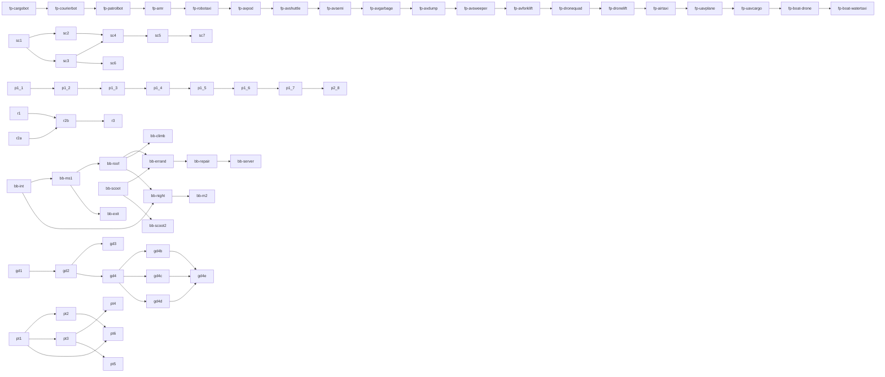

# Build plan (generated by tools/queue.py; edit build_queue.json)

Agents: run `python3 tools/queue.py next`, build it, then `python3 tools/queue.py done <id>`,
commit, push to `consistency-pass`. `[ ]` pending, `[?]` built, awaiting Sir's test, `[x]` signed off, `[!]` waiting on Sir, `[-]` dead (dropped).

## Dependencies

## Fleet polish (in order)
- [?] `fp-cargobot` Fleet polish: Cargo bot. Draw it, screenshot it from four headings, Sir signs off, then the next. Skip Tipsey and Gideon. It wears everything Tipsey has (paint, finish, print, stripe, flag, face) and the standing rules in docs/fleet-redesign.md "Fleet polish: the standing rules". (parcel hatches on both flanks, pushed to main 9122db1) [test](https://claude.ai/artifact/8vSYEJ9qmc2p4dhPpbWdKC) [docs/fleet-redesign.md]
- [?] `fp-courierbot` Fleet polish: Courier bot. Draw it, screenshot it from four headings, Sir signs off, then the next. Skip Tipsey and Gideon. It wears everything Tipsey has (paint, finish, print, stripe, flag, face) and the standing rules in docs/fleet-redesign.md "Fleet polish: the standing rules". [test](https://claude.ai/artifact/2gwNg67gKaYXjWHAjAZHBi) [docs/fleet-redesign.md]
- [ ] `fp-patrolbot` Fleet polish: Security patrol robot. Draw it, screenshot it from four headings, Sir signs off, then the next. Skip Tipsey and Gideon. It wears everything Tipsey has (paint, finish, print, stripe, flag, face) and the standing rules in docs/fleet-redesign.md "Fleet polish: the standing rules". [docs/fleet-redesign.md]
- [ ] `fp-amr` Fleet polish: Warehouse robot (AMR). Draw it, screenshot it from four headings, Sir signs off, then the next. Skip Tipsey and Gideon. It wears everything Tipsey has (paint, finish, print, stripe, flag, face) and the standing rules in docs/fleet-redesign.md "Fleet polish: the standing rules". [docs/fleet-redesign.md]
- [ ] `fp-robotaxi` Fleet polish: Robotaxi. Draw it, screenshot it from four headings, Sir signs off, then the next. Skip Tipsey and Gideon. It wears everything Tipsey has (paint, finish, print, stripe, flag, face) and the standing rules in docs/fleet-redesign.md "Fleet polish: the standing rules". [docs/fleet-redesign.md]
- [ ] `fp-avpod` Fleet polish: Delivery pod. Draw it, screenshot it from four headings, Sir signs off, then the next. Skip Tipsey and Gideon. It wears everything Tipsey has (paint, finish, print, stripe, flag, face) and the standing rules in docs/fleet-redesign.md "Fleet polish: the standing rules". [docs/fleet-redesign.md]
- [ ] `fp-avshuttle` Fleet polish: Autonomous shuttle. Draw it, screenshot it from four headings, Sir signs off, then the next. Skip Tipsey and Gideon. It wears everything Tipsey has (paint, finish, print, stripe, flag, face) and the standing rules in docs/fleet-redesign.md "Fleet polish: the standing rules". [docs/fleet-redesign.md]
- [ ] `fp-avsemi` Fleet polish: Autonomous semi. Draw it, screenshot it from four headings, Sir signs off, then the next. Skip Tipsey and Gideon. It wears everything Tipsey has (paint, finish, print, stripe, flag, face) and the standing rules in docs/fleet-redesign.md "Fleet polish: the standing rules". [docs/fleet-redesign.md]
- [ ] `fp-avgarbage` Fleet polish: Robo garbage truck. Draw it, screenshot it from four headings, Sir signs off, then the next. Skip Tipsey and Gideon. It wears everything Tipsey has (paint, finish, print, stripe, flag, face) and the standing rules in docs/fleet-redesign.md "Fleet polish: the standing rules". [docs/fleet-redesign.md]
- [ ] `fp-avdump` Fleet polish: Autonomous dump truck. Draw it, screenshot it from four headings, Sir signs off, then the next. Skip Tipsey and Gideon. It wears everything Tipsey has (paint, finish, print, stripe, flag, face) and the standing rules in docs/fleet-redesign.md "Fleet polish: the standing rules". [docs/fleet-redesign.md]
- [ ] `fp-avsweeper` Fleet polish: Robo street sweeper. Draw it, screenshot it from four headings, Sir signs off, then the next. Skip Tipsey and Gideon. It wears everything Tipsey has (paint, finish, print, stripe, flag, face) and the standing rules in docs/fleet-redesign.md "Fleet polish: the standing rules". [docs/fleet-redesign.md]
- [ ] `fp-avforklift` Fleet polish: Driverless forklift. Draw it, screenshot it from four headings, Sir signs off, then the next. Skip Tipsey and Gideon. It wears everything Tipsey has (paint, finish, print, stripe, flag, face) and the standing rules in docs/fleet-redesign.md "Fleet polish: the standing rules". [docs/fleet-redesign.md]
- [ ] `fp-dronequad` Fleet polish: Delivery drone. Draw it, screenshot it from four headings, Sir signs off, then the next. Skip Tipsey and Gideon. It wears everything Tipsey has (paint, finish, print, stripe, flag, face) and the standing rules in docs/fleet-redesign.md "Fleet polish: the standing rules". [docs/fleet-redesign.md]
- [ ] `fp-dronelift` Fleet polish: Heavy-lift drone. Draw it, screenshot it from four headings, Sir signs off, then the next. Skip Tipsey and Gideon. It wears everything Tipsey has (paint, finish, print, stripe, flag, face) and the standing rules in docs/fleet-redesign.md "Fleet polish: the standing rules". [docs/fleet-redesign.md]
- [ ] `fp-airtaxi` Fleet polish: Air taxi. Draw it, screenshot it from four headings, Sir signs off, then the next. Skip Tipsey and Gideon. It wears everything Tipsey has (paint, finish, print, stripe, flag, face) and the standing rules in docs/fleet-redesign.md "Fleet polish: the standing rules". [docs/fleet-redesign.md]
- [ ] `fp-uavplane` Fleet polish: Delivery drone plane. Draw it, screenshot it from four headings, Sir signs off, then the next. Skip Tipsey and Gideon. It wears everything Tipsey has (paint, finish, print, stripe, flag, face) and the standing rules in docs/fleet-redesign.md "Fleet polish: the standing rules". [docs/fleet-redesign.md]
- [ ] `fp-uavcargo` Fleet polish: Long-range cargo drone. Draw it, screenshot it from four headings, Sir signs off, then the next. Skip Tipsey and Gideon. It wears everything Tipsey has (paint, finish, print, stripe, flag, face) and the standing rules in docs/fleet-redesign.md "Fleet polish: the standing rules". [docs/fleet-redesign.md]
- [ ] `fp-boat-drone` Fleet polish: Survey boat. Draw it, screenshot it from four headings, Sir signs off, then the next. Skip Tipsey and Gideon. It wears everything Tipsey has (paint, finish, print, stripe, flag, face) and the standing rules in docs/fleet-redesign.md "Fleet polish: the standing rules". [docs/fleet-redesign.md]
- [ ] `fp-boat-watertaxi` Fleet polish: Water taxi. Draw it, screenshot it from four headings, Sir signs off, then the next. Skip Tipsey and Gideon. It wears everything Tipsey has (paint, finish, print, stripe, flag, face) and the standing rules in docs/fleet-redesign.md "Fleet polish: the standing rules". [docs/fleet-redesign.md]

## People: seeded crowd
- [?] `sc1` World clock + slot scheduler + seeded shoppers (pilot) [docs/seeded-crowd.md]
- [?] `sc2` Seeded residents: houses, scooter trips, dog walkers [docs/seeded-crowd.md]
- [?] `sc3` Seeded seekers, errand drivers, food-truck customers [docs/seeded-crowd.md]
- [?] `sc4` Seeded strand, boardwalk, almshouse court and the other live populations [docs/seeded-crowd.md]
- [?] `sc5` Census: same seed, two boots, every CITY_PEOPLE group the same [docs/seeded-crowd.md]
- [?] `sc6` Seeded traffic: loop clocks on the world clock, hold only near him and decayed to zero out of sight, errand cars and food-truck sessions scheduled; loop offsets staggered so shared streets don't overlap [docs/seeded-crowd.md]
- [?] `sc7` Census leftovers onto the seed: the groups in tools/crowd_census_known.json stay on the known list (decided: left) [docs/seeded-crowd.md]

## People unification
- [?] `p1.1` Fold mall offset into mallWalkerAt return; drop m.oa/m.ob at 3 call sites [docs/people-unification.md#plan-by-risk]
- [?] `p1.2` One loopWalkStep for ballroom + derby walkers (identical positions) [docs/people-unification.md]
- [x] `p1.3` One pathAt replacing mallStaffAt + hospWalkerAt (skipped: the hospital walk is a racetrack loop, not a two-point ping-pong) [docs/people-unification.md]
- [?] `p1.4` One talkRun for ballroom/derby chatter (visible change) [docs/people-unification.md]
- [?] `p1.5` EXCUSE table + excuseSay (hospital visible change) [docs/people-unification.md]
- [x] `p1.6` Looks through partyLook, old generators as aliases (already done in the code: staffLook and mallJailLook are rosterBody aliases, storeRepLook and tixLooks build on it, the inline lookOf is mallJailLook) [docs/people-unification.md]
- [?] `p1.7` Derby onto scene.time.now [docs/people-unification.md]
- [?] `p2.8` PEOPLE registry (updateKnocks, blockAt, hospital walkers solid) [docs/people-unification.md]

## Roadmap: routes, ramps, editor
- [?] `r1` Dev challenge routes data plumbing [test](https://cal-starfur.github.io/Tipsy/consistency-pass/?route=tight-1) [docs/roadmap.md#phase-1]
- [?] `r2a` Ramp/kicker lab bench, all 4 headings [test](https://cal-starfur.github.io/Tipsy/consistency-pass/labs/ramp-jump.html) [docs/ramp-jump-spec.md]
- [?] `r2b` Port ramp/kicker + ring of fire into game/index.html, debut in a challenge route [test](https://cal-starfur.github.io/Tipsy/consistency-pass/?route=tight-1&go=10440,5720,0&view=2) [docs/ramp-jump-spec.md]
- [-] `r3` Community route editor [docs/roadmap.md#phase-3]

## Specs (waiting on decisions)
- [!] `s1` Onboarding level 'Learn the Ropes' (needs hazard choice, menu label) [docs/onboarding-spec.md]
- [!] `s2` Skins redemption-code model (needs price, launch count, code format) [docs/skins-spec.md]
- [!] `s3` Keepsakes data shape + story 'Fourth Place' (needs save-across-devices, mission data) [docs/keepsakes.md]
- [!] `s4` Museum story 'The Last Bone' (needs story, pickup place, reward) [docs/museum-mission.md]

## Consistency pass: doors
- [?] `d1` Working door: Seabreeze Ballroom (doorF records itself) [test](https://cal-starfur.github.io/Tipsy/consistency-pass/?go=26588,2812&view=3) [docs/state/CONSISTENCY_PASS.md#still-to-do]
- [?] `d2` Working door: Animal Shelter (painted door today) [test](https://cal-starfur.github.io/Tipsy/consistency-pass/?go=7860,8684&view=3) [docs/state/CONSISTENCY_PASS.md#still-to-do]
- [?] `d3` Working door: harbour boat cabin [docs/state/CONSISTENCY_PASS.md#still-to-do]
- [?] `d4` Working doors: Surfside Diner + Sandpiper Shoes [docs/state/CONSISTENCY_PASS.md#still-to-do]
- [?] `d5` Kai + surf stand door; Low Tide Music door faces away [test](https://cal-starfur.github.io/Tipsy/consistency-pass/?go=-4900,11450&view=2) [docs/state/CONSISTENCY_PASS.md#still-to-do]

## Consistency pass: buildings
- [?] `b1` Tide Pool Elementary in pieces (U1k/U1c) [test](https://cal-starfur.github.io/Tipsy/consistency-pass/?go=22900,-700&view=2) [docs/state/CONSISTENCY_PASS.md#still-to-do]
- [?] `b2` Palmline Tower key + vol, forecourt out of its one image [test](https://cal-starfur.github.io/Tipsy/consistency-pass/?go=5064,-560&view=3) [docs/state/CONSISTENCY_PASS.md#still-to-do]

## Consistency pass: vehicles
- [?] `v1` One vehicleSolid(kind) for the ten parked-car boxes [test](https://cal-starfur.github.io/Tipsy/consistency-pass/?go=20140,14260&view=2) [docs/state/CONSISTENCY_PASS.md#still-to-do]
- [?] `v2` Riders obstacle list + clearance [test](https://cal-starfur.github.io/Tipsy/consistency-pass/?go=4244,15060&view=2) [docs/state/CONSISTENCY_PASS.md#still-to-do]
- [?] `v3` Parking rows cached, one bay size [test](https://cal-starfur.github.io/Tipsy/consistency-pass/?go=29038,1564&view=2) [docs/state/CONSISTENCY_PASS.md#still-to-do]
- [?] `v4` Showroom cars on gameCar [test](https://cal-starfur.github.io/Tipsy/consistency-pass/?go=23764,18102&view=2) [docs/state/CONSISTENCY_PASS.md#still-to-do]
- [?] `v5` Route car out of the far lane [test](https://cal-starfur.github.io/Tipsy/consistency-pass/?view=2) [docs/state/CONSISTENCY_PASS.md#still-to-do]

## Consistency pass: people
- [?] `pe1` Legs driven by distance walked (47 walkSin calls) [test](https://cal-starfur.github.io/Tipsy/consistency-pass/?go=14076,-746&view=2) [docs/state/CONSISTENCY_PASS.md#still-to-do]
- [?] `pe2` Unlisted populations into CITY_PEOPLE (knockable batch: Sierra guard made knockable; duplicate food-truck entry removed; the rest were already listed (docs stale). Marisol/cook, hospital errand/jail/rescue: mission timelines, left) [test](https://cal-starfur.github.io/Tipsy/consistency-pass/?go=17640,2392&view=2) [docs/state/CONSISTENCY_PASS.md#still-to-do]
- [?] `pe3` Merge the two meet-spot pickers; meetCoverAt beyond street + mall (meetSide: one side chooser (lhSide/ohSide/kwSide/rlSide, tix, lost item); meetSpot was already the one picker; meetCoverAt in other interiors left) [docs/state/CONSISTENCY_PASS.md#still-to-do]
- [?] `pe4` Forno cook counter post; R6 on Tipsey himself (cook post and R6 on Tipsey (carried item on his lid) built) [docs/state/CONSISTENCY_PASS.md#still-to-do]

## Consistency pass: props
- [?] `pr1` Prop collision taken from the art (lamp, hydrant, palm, bin, bench) [test](https://cal-starfur.github.io/Tipsy/consistency-pass/?go=11426,2640&view=2) [docs/state/CONSISTENCY_PASS.md#still-to-do]
- [?] `pr2` Keep-clear of doors and mats [test](https://cal-starfur.github.io/Tipsy/consistency-pass/?go=8648,1597&view=2) [docs/state/CONSISTENCY_PASS.md#still-to-do]
- [?] `pr3` Static prop shadows [test](https://cal-starfur.github.io/Tipsy/consistency-pass/?go=8372,2714&view=2) [docs/state/CONSISTENCY_PASS.md#still-to-do]
- [?] `pr4` Pier + harbour still props cached [test](https://cal-starfur.github.io/Tipsy/consistency-pass/?go=-3500,-13800&view=2) [docs/state/CONSISTENCY_PASS.md#still-to-do]

## Walk-in landmarks
- [?] `wk1` Dune Home & Garden [test](https://cal-starfur.github.io/Tipsy/consistency-pass/?go=1475,17216&view=2) [docs/state/walkin_recipe.md]
- [?] `wk2` Saltwater Brewing [test](https://cal-starfur.github.io/Tipsy/consistency-pass/?go=17101,8700&view=2) [docs/state/walkin_recipe.md]
- [?] `wk3` Lagoon Baths [test](https://cal-starfur.github.io/Tipsy/consistency-pass/?go=1564,8577&view=2) [docs/state/walkin_recipe.md]
- [?] `wk4` Driftwood Chapel [test](https://cal-starfur.github.io/Tipsy/consistency-pass/?go=7821,11600&view=2) [docs/state/walkin_recipe.md]
- [?] `wk5` Palmline Nursery [test](https://cal-starfur.github.io/Tipsy/consistency-pass/?go=4693,11600&view=2) [docs/state/walkin_recipe.md]
- [?] `wk6` Animal Shelter interior [test](https://cal-starfur.github.io/Tipsy/consistency-pass/?go=7820,8444&view=3) [docs/state/walkin_recipe.md]
- [?] `wk7` Lagoon Market Hall [test](https://cal-starfur.github.io/Tipsy/consistency-pass/?go=10279,27470&view=2) [docs/state/walkin_recipe.md]
- [?] `wk8` Ferris Taylor Cottages [test](https://cal-starfur.github.io/Tipsy/consistency-pass/?go=26115,11880&view=2) [docs/state/walkin_recipe.md]
- [?] `wk9` Cove Grove [test](https://cal-starfur.github.io/Tipsy/consistency-pass/?go=1259,27300&view=2) [docs/state/walkin_recipe.md]
- [?] `wk10` Airfield terminal [test](https://cal-starfur.github.io/Tipsy/consistency-pass/?go=26520,21330&view=2) [docs/state/walkin_recipe.md]

## Fleet and missions
- [?] `f2` Fleet P2: rotor flight + The Lighthouse Run [test](https://cal-starfur.github.io/Tipsy/consistency-pass/?go=-4064,-12290&view=2) [docs/state/HANDOFF.md]
- [?] `m1` Trophies alley fence to 0.3 over the room [test](https://cal-starfur.github.io/Tipsy/consistency-pass/?go=410000,400000&view=2) [docs/state/HANDOFF.md]
- [?] `m2` Open House: crosswalk for the captain, live fire on the burn prop [test](https://cal-starfur.github.io/Tipsy/consistency-pass/?go=6260,20300&view=2) [docs/state/HANDOFF.md]
- [?] `m3` KTDE: DJ side missions over the air; station van drives off [test](https://cal-starfur.github.io/Tipsy/consistency-pass/?go=17776,27858&view=2) [docs/state/HANDOFF.md]
- [?] `m4` Letters on the Hill: face wash under roof edges; ranger inside her kiosk [test](https://cal-starfur.github.io/Tipsy/consistency-pass/?go=29330,-800&view=2) [docs/state/HANDOFF.md]

## Needs Sir
- [!] `x1` Fleet lock flip; garage shows big vehicle on pick; pier access for Flats players (decision) [docs/state/HANDOFF.md]
- [!] `x2` Region index follows the lock; Mirador developer; pier lamp + palm sizes (decision) [docs/state/HANDOFF.md]

## Flats dead space
- [!] `da8` Flats dead-space area 8 (details only in the v3 report artifact; needs a look) (confirm what area 8 is) [docs/state/HANDOFF.md]
- [!] `da9` Flats dead-space areas 9 + 12 (moved beyond the Flats) (waiting on region decision) [docs/state/HANDOFF.md]
- [!] `da13` Sunset Pier, area 13 (an edge of University) (waits on University hood lock) [docs/state/HANDOFF.md]
- [?] `cove-flush-s` Cove Grove West Tower's south shops (Seaglass Coffee, Sandbar Gelato) flush to the pavement like the north tower's east shops (coveFlushE): a plinth out from the face, doors and awnings on it. Seaglass is a walk-in (CVC_IN: its room, door holes and slideDoors stand on the tower's face), so its room and door move out with the plinth; the north and west faces are unseen and can follow [found by test run]

## Built, awaiting your test
- [?] `t-motel` Sun Deck Motor Lodge + The Getaway [docs/state/CONSISTENCY_PASS.md]
- [?] `t-kart` Tidewater Kart Works + Number 4 Builds a Winner [docs/state/CONSISTENCY_PASS.md]
- [?] `t-fish` Pelican Fish Market + Catch of the Day [docs/state/CONSISTENCY_PASS.md]
- [?] `t-paw` Paw Point Dog Park + Adoption Day [docs/state/CONSISTENCY_PASS.md]
- [?] `t-vet` Veterans Memorial + Sunset Salute [docs/state/CONSISTENCY_PASS.md]
- [?] `t-surf` Sunset Shore Surf School + Sunset Session [docs/state/CONSISTENCY_PASS.md]
- [?] `t-watch` Vista Ridge Security Post + Night Watch [docs/state/CONSISTENCY_PASS.md]
- [?] `t-ktde` KTDE 98.1 The Tide, whole block + Request Line [docs/state/CONSISTENCY_PASS.md]
- [?] `t-fire` Fire Training Yard + Open House [docs/state/CONSISTENCY_PASS.md]
- [?] `t-letters` Letters on the Hill [docs/state/CONSISTENCY_PASS.md]
- [?] `t-skate` Driftwood Skate Park [test](https://cal-starfur.github.io/Tipsy/consistency-pass/?go=17204,21060,-1.57&view=3) [docs/state/CONSISTENCY_PASS.md]
- [?] `t-museum` Tidewater Museum (no drive, dimmer lanterns) [test](https://cal-starfur.github.io/Tipsy/consistency-pass/?go=10948,2700,0.73&view=3) [docs/state/CONSISTENCY_PASS.md]
- [?] `t-trophies` Seabreeze Trophies + Pelican Drug walk-ins [docs/state/CONSISTENCY_PASS.md]
- [?] `t-rules` Shared rules: one door rule, meet walk, crew pace, no fades, order/solids/cache [test](https://cal-starfur.github.io/Tipsy/consistency-pass/?go=shops&view=2) [docs/state/CONSISTENCY_PASS.md]

## Fixes from testing
- [x] `museum-footprint` Maritime Museum: red footprint (LAB 1460x856) covers only the front ~55% of the shell's depth; inside photo shows the whole building. Red also sits ~25px (~35 units) out in front of the long face wall base. Needs a decision: make LAB the full shell or confirm the rear is not a room [test](https://cal-starfur.github.io/Tipsy/consistency-pass/?go=10948,1688&view=3) [found by test run]
- [?] `vista-footprint` Vista Ridge Security Post: red footprint ends ~45px (~55 units) short of the shell's east wall; rest matches [test](https://cal-starfur.github.io/Tipsy/consistency-pass/?go=9090,-6090&view=2) [found by test run]
- [?] `trophies-footprint` Seabreeze Trophies: red footprint sits ~25-30px (~35 units) forward of the shell wall base on the west end; size matches (760x600). Right/gate side hidden, not judged [test](https://cal-starfur.github.io/Tipsy/consistency-pass/?go=4274,14974&view=2) [found by test run]
- [?] `pelican-walltop` Pelican room walls H 232 vs shell cornice 348 world (232 kit x ZSCALE 1.5): set PELICAN_IN H 348 [test](https://cal-starfur.github.io/Tipsy/consistency-pass/?go=20141,14064&view=2) [found by test run]
- [?] `kart-yard` Kart Works yard: the block's bare brown-checker centre becomes the club's practice loop with cones, tyre barriers, start gantry, pit canopy and benches [test](https://cal-starfur.github.io/Tipsy/consistency-pass/?go=4204,13628&view=2) [found by test run]
- [?] `kart-yard-fence` Kart Works block: the open frontages fenced in the alley gate's iron (north, west, east between barn and depot) [test](https://cal-starfur.github.io/Tipsy/consistency-pass/?go=4692,14076&view=3) [found by test run]
- [?] `kart-works-shell` Tidewater Kart Works: shell was smaller than its room's outer walls; widened to 820 x 680, east frontage becomes an alley gate [test](https://cal-starfur.github.io/Tipsy/consistency-pass/?go=5630,13658&view=3) [found by test run]
- [x] `fleet-apron` Marina Parking: pale flat paving rectangle left of the garage entry reads lighter than neighbouring slabs, and the asphalt apron ends in a diagonal flat cut against the paving (wide photo, left of ENTER sign). May be intentional; needs Sir's eye. [test](https://cal-starfur.github.io/Tipsy/consistency-pass/?go=1600,21300&view=3) [found by test run]
- [?] `skate-sign` Driftwood Skate Park street sign: board keyed at its middle, so fence pieces to its right painted over the text ('DRIFTWOO' cut off); keyed at its right end now [test](https://cal-starfur.github.io/Tipsy/consistency-pass/?go=17510,21142&view=2) [found by test run]
- [?] `skate-lamps` Flood pole lamp heads read as tan cardboard boxes at night (shared queueLandmarkLamps glow, also on other landmarks); needs a decision/art from Sir [test](https://cal-starfur.github.io/Tipsy/consistency-pass/?go=17204,21060&view=3) [found by test run]
- [?] `port-fanlight` Port Office fanlight/window arch drawn as full ellipse: lower half painted over door glass and upper half over the PORT OFFICE sign [test](https://cal-starfur.github.io/Tipsy/consistency-pass/?go=-3500,-13800&view=2) [found by test run]
- [ ] `harbor-boats` Pelican Harbor trailer boats and trailers still not up to par: boat floats above the trailer and the hull reads see-through (the fill check found neither; the mid-air water shadow is fixed, red bottom paint and ground shadow added, but the hull is still pale and the flank hard to read, winch/bow end cluttered, near wheel heavy, motorboat trailer not re-checked). Needs a proper pass on drawHarborTrailer and the Harbor Boat when trailered. [test](https://cal-starfur.github.io/Tipsy/consistency-pass/?go=-2076,-1150,3.14&view=2) [found by test run]

## Brew & Bolt: Minding the Shop
- [?] `bb-ext` Exterior character: copper-and-cream brick plinth, frieze, goosenecks, corner blade, rooftop cups; the east flank matches the front (shopfront band, awnings, glass, cornice) [test](https://cal-starfur.github.io/Tipsy/consistency-pass/?go=4700,15500&view=3) [docs/kits/missions.md]
- [?] `bb-int` Interior: service counter (espresso machine, pastry case, till, stools), back bar, brick dado, neon bolt and Gideon mural, rugs, robot charging nook; Gideon is the game's own humanoid; planters kept off the footprint [test](https://cal-starfur.github.io/Tipsy/consistency-pass/?go=460418,430450&view=2) [docs/kits/missions.md]
- [?] `bb-ms1` Mission opens: Brew & Bolt's mat is the mission's (robot-head icon, no ordinary orders); Gideon comes out and asks; Not now works; the player becomes Gideon (humanoid loan); Tipsey rolls in and works the counter (NIGHT_CLOCK.time = 11) [test](https://cal-starfur.github.io/Tipsy/consistency-pass/?go=5102,15097&view=2) [docs/kits/missions.md]
- [?] `bb-scoot` The humanoid can hop on any city scooter (Hop on / Hop off button) and ride it (needs the humanoid: start the mission, or FLEET_LOAN = 'humanoid') [test](https://cal-starfur.github.io/Tipsy/consistency-pass/?go=9000,9000&view=2) [docs/kits/missions.md]
- [?] `bb-roof` The roof: the back room's ladder and hatch, a second room on the same square above the shop (Brew & Bolt Roof), bent antenna mast, the inspection card, back down the hatch [test](https://cal-starfur.github.io/Tipsy/consistency-pass/?go=470300,430250&view=2) [docs/kits/missions.md]
- [?] `bb-errand` The parts errand: Gideon rides a scooter to Breakwater Hardware (about 33,000 road units, 6.5 min by GPS: consider a nearer parts shop), the clerk hands over a mast bracket and a coax connector (carried item), beacon and GPS there and back [test](https://cal-starfur.github.io/Tipsy/consistency-pass/?go=5102,15097&view=2) [docs/kits/missions.md]
- [?] `bb-repair` The repair and finish: back up the ladder, the mast straightened and the cable fixed, the order screen lights, Gideon's thanks, one completion card [test](https://cal-starfur.github.io/Tipsy/consistency-pass/?go=5102,15097&view=2) [docs/kits/missions.md]
- [?] `bb-server` Mission records: TS_MISSIONS 'minding-the-shop' (tipsey-delivery/src/server/tpcatalog.ts), reward ids (db.ts), trophy and skin entries if any, MISSIONS reward, mission-board listing and place-card text, missions.md row and seed line. Reward decided (Sir): Gideon playable, the humanoid's fleet unlock; no trophy, skin or cash [test](https://cal-starfur.github.io/Tipsy/consistency-pass/?go=5102,15097&view=2) [docs/kits/missions.md]
- [?] `bb-exit` Replace the temporary 'parts' bay that hands the shop back: Tipsey leaves the counter and the loan ends where Gideon finishes; abort and quit paths (leave mid-mission, tip over, reload) keep nothing half-done [test](https://cal-starfur.github.io/Tipsy/consistency-pass/?go=5102,15097&view=2) [docs/kits/missions.md]
- [?] `bb-climb` Climb polish: the ladder art stretched to the real 343 climb, the hatch opens visibly from inside, a walked climb instead of the dissolve, roof collisions (parapet, mast, vent, hatch curb) checked by walking [test](https://cal-starfur.github.io/Tipsy/consistency-pass/?go=470300,430250&view=2) [docs/kits/missions.md]
- [?] `bb-scoot2` Scooter polish: tune top speed and turning, gate pedestrian knocks and police while riding, dismount rules (doors, loans ending), scooters set down stay put on reload [test](https://cal-starfur.github.io/Tipsy/consistency-pass/?go=9000,9000&view=2) [docs/kits/missions.md]
- [?] `bb-night` Night pass: the interior's neon bolt and counter, the exterior lamps, the roof, the robot-head beacon after dark (NIGHT_CLOCK.time = 22) [test](https://cal-starfur.github.io/Tipsy/consistency-pass/?go=5102,15097&view=2&night=1) [docs/kits/missions.md]
- [!] `bb-m2` Second Gideon / Brew & Bolt mission (story, giver, place, reward and window still to decide with Sir; Gideon is playable now, the shop and roof are built) (needs the story) [docs/kits/missions.md]

## Gideon's pad
- [?] `gd1` Gideon's charging pad in the back room (the same round pad as Tipsey's; the roaster stays) [test](https://cal-starfur.github.io/Tipsy/consistency-pass/?go=460124,430266&view=2) [docs/gideon-dock.md]
- [?] `gd2` Choosing the humanoid in the fleet starts you as Gideon on his pad in the back room (not Tipsey's station) [test](https://cal-starfur.github.io/Tipsy/consistency-pass/?view=2) [docs/gideon-dock.md]
- [?] `gd3` The pad charges him: its glow breathes, battery fills on it (and, as ever, at any of Tipsey's charging stations) [test](https://cal-starfur.github.io/Tipsy/consistency-pass/?view=2) [docs/gideon-dock.md]
- [?] `gd4` Customise Gideon, tranche 1: his own garage tabs (Shell, Face, Band & pack, Feet) from his pad, 16 shells, colour wheels, 6 eye shapes, 7 mouths, bands, pack, joints, hands, 4 shoe kinds; kept in the profile and drawn on him everywhere [test](https://cal-starfur.github.io/Tipsy/consistency-pass/?view=2) [docs/gideon-dock.md]
- [?] `gd4b` Gideon's Head tab: 12 headwear styles (flat cap, beanie, bowler, top hat, chef's hat, headphones, antenna, twin antennas, visor, party hat, crown, propeller cap) in any colour, on Tipsey's paint system [test](https://cal-starfur.github.io/Tipsy/consistency-pass/?view=2) [docs/gideon-dock.md]
- [?] `gd4c` Gideon's Outfit tab: apron, vest, scarf, bow tie, tie, 5 badges, 5 glasses, and 5 pack styles (Band & pack tab), each in any colour, on Tipsey's paint system [test](https://cal-starfur.github.io/Tipsy/consistency-pass/?view=2) [docs/gideon-dock.md]
- [?] `gd4d` Gideon's Finish and Decals tabs: satin, matte, gloss, chrome, two-tone (second colour on the legs); racing stripes, chevron, star, bolt, heart, race numbers 1/4/7/9 in any colour [test](https://cal-starfur.github.io/Tipsy/consistency-pass/?view=2) [docs/gideon-dock.md]
- [?] `gd4e` Gideon's Looks tab: 10 ready-made looks (Stock, Barista, Night Shift, Chrome, Workshop, Sunset, Racer, Chef, Royal, Party), tried on whole and added to the cart together at the parts' prices [test](https://cal-starfur.github.io/Tipsy/consistency-pass/?view=2) [docs/gideon-dock.md]

## Walk-in kit fit
- [?] `kf-dune` Dune Home & Garden: shell +30 west and north (check east and south by eye), then the door and fixtures (W22-W24) [docs/state/walkin_kit_fit.md]
- [?] `kf-tpe` Tide Pool Elementary: shell +30 on all four sides, then the door and fixtures (W22-W24) [test](https://cal-starfur.github.io/Tipsy/consistency-pass/?go=23468,-1006&view=2) [docs/state/walkin_kit_fit.md]
- [?] `kf-museum` Tidewater Museum: shell +30 on all four sides, then the door and fixtures (W22-W24) [test](https://cal-starfur.github.io/Tipsy/consistency-pass/?go=10948,1688&view=2) [docs/state/walkin_kit_fit.md]
- [?] `kf-shelter` Costa Palma Animal Shelter: shell +30 on every side, then the door and fixtures (W22-W24) [test](https://cal-starfur.github.io/Tipsy/consistency-pass/?go=1564,-706&view=2) [docs/state/walkin_kit_fit.md]
- [?] `kf-brew` Brew & Bolt: shell +30 on every side, then the door and fixtures (W22-W24) [test](https://cal-starfur.github.io/Tipsy/consistency-pass/?go=5102,14934&view=2) [docs/state/walkin_kit_fit.md]
- [?] `kf-ktde` KTDE 98.1 The Tide: shell +30 on every side, then the door and fixtures (W22-W24) [test](https://cal-starfur.github.io/Tipsy/consistency-pass/?go=16981,27344&view=2) [docs/state/walkin_kit_fit.md]
- [?] `kf-motel` Sun Deck Motor Lodge Office: shell +30 on every side, then the door and fixtures (W22-W24) [test](https://cal-starfur.github.io/Tipsy/consistency-pass/?go=25930,17770&view=2) [docs/state/walkin_kit_fit.md]
- [?] `kf-kart` Tidewater Kart Works: shell +30 on the front (check the other sides by eye), then the door and fixtures (W22-W24) [test](https://cal-starfur.github.io/Tipsy/consistency-pass/?go=5520,13658&view=2) [docs/state/walkin_kit_fit.md]
- [?] `kf-vista` Vista Ridge Security Post: the room stands in front of the building, not under it: re-measure the footprint, then shell +30 and the door and fixtures (W22-W24) [test](https://cal-starfur.github.io/Tipsy/consistency-pass/?go=9090,-5960&view=2) [docs/state/walkin_kit_fit.md]
- [?] `kf-trophies` Seabreeze Trophies: shell fits; look inside at the door and the near walls for W23 and W24 [test](https://cal-starfur.github.io/Tipsy/consistency-pass/?go=4274,14904&view=2) [docs/state/walkin_kit_fit.md]
- [?] `kf-check` Kit check: every exterior declares its footprint so walkinCoverage() measures all eleven (seven read "not declared" today), and run_sheet --walkins fails on a SHORT [test](node tools/run_sheet.js --walkins: 19 of 19 'cover ok', exits 1 on a SHORT or NOT DECLARED) [docs/state/walkin_kit_fit.md]
- [?] `kf-night` Night cut: the Seabreeze Ballroom and the Tidewater Museum write their own night boxes and reach over their near walls (walkinNightCheck says LEAK): move them to the kit's walkinNightBoxes or fix their boxes, then look inside at night (W25) [test](https://cal-starfur.github.io/Tipsy/consistency-pass/?go=26588,2462&view=2) [docs/state/walkin_kit_fit.md]
- [?] `kf-new` The rooms built since the audit (Saltwater Brewing, Lagoon Baths, Driftwood Chapel, Palmline Nursery, Lagoon Market Hall, Ferris Taylor Cottage, Seaglass Coffee; Cove Grove and the Airfield terminal once they are in the sheet): look inside at the door and the near walls for W23 and W24, and confirm W22 by eye where it reads 'not declared' [test](https://cal-starfur.github.io/Tipsy/consistency-pass/?go=20140,14260&view=2) [docs/state/walkin_kit_fit.md]
- [?] `kf-big` Shell coverage and W23/W24 for the three rooms the walk-in sheet leaves out: the Seabreeze Ballroom, Marina General Hospital and the Maritime Mall (their exteriors are drawn in pieces on their own frames, so measure each against its walls' outer face by eye, then fix what is short) [test](https://cal-starfur.github.io/Tipsy/consistency-pass/?go=26588,2462&view=2) [docs/state/walkin_kit_fit.md]

## Parked (waiting on Sir)
- [ ] `fleet-spots` Fleet test spots (Marina Parking bays 1600,21300; fuel farm hall 26280,26800; harbour boathouse -5500,-12150) frame a garage ramp, fuel tanks and a yacht, not fleet bays; no bay doors/pads/big-vehicle bays visible in any photo, so item 1-2 could not be judged. Needs Sir to give the real bay coordinates. [test](https://cal-starfur.github.io/Tipsy/consistency-pass/?go=1600,21300&view=2) [found by test run]
- [ ] `fleet-spots` Spots now point at the real hall centres from FLEET_HALL_DEFS (F3 1020/2226,21031; F4 26280,26588; F2b -5500,-12546; F7h 27990,20420), but no bays draw anywhere because FLEET_BAYS_BUILT=false (game/index.html:5191) switches all fleet halls off. Needs Sir: flip it on (re-test) or leave the bays out. [test](https://cal-starfur.github.io/Tipsy/consistency-pass/?go=26280,26588&view=2) [found by test run]

## Palmline Tower interior
- [ ] `pt1` Palmline Tower lobby as a real walk-in room: reception, security desk, four lifts, bench, mail wall; receptionist and guard, tenants and couriers; sliding doors for the two door pairs; delivery hand-over at the desk [docs/palmline-tower-plan.md]
- [ ] `pt2` Coral Cafe and Marina Deli as real rooms (the mall's coffee and deli fittings), barista and deli clerk, their doors become slideDoors [docs/palmline-tower-plan.md]
- [ ] `pt3` Palmline Tower lifts: lobby, podium roof terrace and tenant-floor stops, floor changes fade (garage/hospital lift kit) [docs/palmline-tower-plan.md]
- [ ] `pt4` Palmline Tower tenant floors, three or four of the twelve (office suite, dental practice, newsroom or studio, roof gym), each with a front desk and staff. Needs Sir to choose the tenants [docs/palmline-tower-plan.md]
- [ ] `pt5` Palmline Tower roof and crown: plant room, mast light at night [docs/palmline-tower-plan.md]
- [ ] `pt6` Palmline Tower night: walkinNightBoxes for each room, lobby and shops lit after dark [docs/palmline-tower-plan.md]

## Walk-in interiors: Flats shops
- [ ] `wi-palmline-garage` Walk-in interior: Palmline Garage (block 2,0 edge 0) [docs/state/walkin_recipe.md]
- [ ] `wi-palmline-savings` Walk-in interior: Palmline Savings (block 2,0 edge 0) [docs/state/walkin_recipe.md]
- [ ] `wi-tidewater-tea-house` Walk-in interior: Tidewater Tea House (block 2,0 edge 1) [docs/state/walkin_recipe.md]
- [ ] `wi-driftwood-books` Walk-in interior: Driftwood Books (block 2,0 edge 1) [docs/state/walkin_recipe.md]
- [ ] `wi-marina-optical` Walk-in interior: Marina Optical (block 2,0 edge 1) [docs/state/walkin_recipe.md]
- [ ] `wi-lagoon-coffee-roasters` Walk-in interior: Lagoon Coffee Roasters (block 2,0 edge 2) [docs/state/walkin_recipe.md]
- [ ] `wi-sandpiper-bakery` Walk-in interior: Sandpiper Bakery (block 2,0 edge 2) [docs/state/walkin_recipe.md]
- [ ] `wi-seabreeze-florist` Walk-in interior: Seabreeze Florist (block 2,0 edge 2) [docs/state/walkin_recipe.md]
- [ ] `wi-low-tide-juice-bar` Walk-in interior: Low Tide Juice Bar (block 2,0 edge 3) [docs/state/walkin_recipe.md]
- [ ] `wi-surfside-fitness` Walk-in interior: Surfside Fitness (block 2,0 edge 3) [docs/state/walkin_recipe.md]
- [ ] `wi-driftwood-home` Walk-in interior: Driftwood Home (block 3,1 edge 0) [docs/state/walkin_recipe.md]
- [ ] `wi-sandpiper-shoes` Walk-in interior: Sandpiper Shoes (block 3,1 edge 0) [docs/state/walkin_recipe.md]
- [ ] `wi-sandcastle-toys` Walk-in interior: Sandcastle Toys (block 3,1 edge 1) [docs/state/walkin_recipe.md]
- [ ] `wi-cove-pottery` Walk-in interior: Cove Pottery (block 3,1 edge 1) [docs/state/walkin_recipe.md]
- [ ] `wi-pelican-pets` Walk-in interior: Pelican Pets (block 3,1 edge 1) [docs/state/walkin_recipe.md]
- [ ] `wi-cove-creamery` Walk-in interior: Cove Creamery (block 3,1 edge 2) [docs/state/walkin_recipe.md]
- [ ] `wi-palmline-bikes` Walk-in interior: Palmline Bikes (block 3,1 edge 2) [docs/state/walkin_recipe.md]
- [ ] `wi-pelican-photo` Walk-in interior: Pelican Photo (block 3,1 edge 2) [docs/state/walkin_recipe.md]
- [ ] `wi-low-tide-records` Walk-in interior: Low Tide Records (block 3,1 edge 2) [docs/state/walkin_recipe.md]
- [ ] `wi-sandpiper-suds` Walk-in interior: Sandpiper Suds (block 3,1 edge 2) [docs/state/walkin_recipe.md]
- [ ] `wi-the-flats-post-office` Walk-in interior: The Flats Post Office (block 8,1 edge 0) [docs/state/walkin_recipe.md]
- [ ] `wi-seabreeze-grocer` Walk-in interior: Seabreeze Grocer (block 8,1 edge 0) [docs/state/walkin_recipe.md]
- [ ] `wi-breakwater-hardware` Walk-in interior: Breakwater Hardware (block 8,1 edge 0) [docs/state/walkin_recipe.md]
- [ ] `wi-the-tide-gazette` Walk-in interior: The Tide Gazette (block 8,1 edge 1) [docs/state/walkin_recipe.md]
- [ ] `wi-seabreeze-playhouse` Walk-in interior: Seabreeze Playhouse (block 8,1 edge 2) [docs/state/walkin_recipe.md]
- [ ] `wi-low-tide-barbers` Walk-in interior: Low Tide Barbers (block 8,1 edge 3) [docs/state/walkin_recipe.md]
- [ ] `wi-cove-apothecary` Walk-in interior: Cove Apothecary (block 8,1 edge 3) [docs/state/walkin_recipe.md]
- [ ] `wi-marina-pharmacy` Walk-in interior: Marina Pharmacy (block 8,1 edge 3) [docs/state/walkin_recipe.md]
- [ ] `wi-lagoon-noodle-bar` Walk-in interior: Lagoon Noodle Bar (block 8,1 edge 3) [docs/state/walkin_recipe.md]
- [ ] `wi-low-tide-tv-radio` Walk-in interior: Low Tide TV & Radio (block 1,6 edge 0) [docs/state/walkin_recipe.md]
- [ ] `wi-surfside-diner` Walk-in interior: Surfside Diner (block 1,6 edge 0) [docs/state/walkin_recipe.md]
- [ ] `wi-seabreeze-picture-house` Walk-in interior: Seabreeze Picture House (block 1,6 edge 0) [docs/state/walkin_recipe.md]
- [ ] `wi-the-flats-fire-station` Walk-in interior: The Flats Fire Station (block 1,6 edge 1) [docs/state/walkin_recipe.md]
- [ ] `wi-seabreeze-hats` Walk-in interior: Seabreeze Hats (block 1,6 edge 1) [docs/state/walkin_recipe.md]
- [ ] `wi-tidewater-press` Walk-in interior: Tidewater Press (block 1,6 edge 2) [docs/state/walkin_recipe.md]
- [ ] `wi-sandpiper-guest-house` Walk-in interior: Sandpiper Guest House (block 1,6 edge 3) [docs/state/walkin_recipe.md]
- [ ] `wi-cove-fish-co` Walk-in interior: Cove Fish Co. (block 1,6 edge 3) [docs/state/walkin_recipe.md]
- [ ] `wi-pelican-cantina` Walk-in interior: Pelican Cantina (block 1,6 edge 3) [docs/state/walkin_recipe.md]
- [ ] `wi-tidewater-news` Walk-in interior: Tidewater News (block 1,6 edge 3) [docs/state/walkin_recipe.md]
- [ ] `wi-the-sandpiper-arms` Walk-in interior: The Sandpiper Arms (block 7,4 edge 0) [docs/state/walkin_recipe.md]
- [ ] `wi-saltwater-sweets` Walk-in interior: Saltwater Sweets (block 7,4 edge 0) [docs/state/walkin_recipe.md]
- [ ] `wi-tidewater-clocks` Walk-in interior: Tidewater Clocks (block 7,4 edge 0) [docs/state/walkin_recipe.md]
- [ ] `wi-breakwater-ironworks` Walk-in interior: Breakwater Ironworks (block 7,4 edge 1) [docs/state/walkin_recipe.md]
- [ ] `wi-sea-glass-exchange` Walk-in interior: Sea Glass Exchange (block 7,4 edge 1) [docs/state/walkin_recipe.md]
- [ ] `wi-marina-flats` Walk-in interior: Marina Flats (block 7,4 edge 2) [docs/state/walkin_recipe.md]
- [ ] `wi-sunfish-arcade` Walk-in interior: Sunfish Arcade (block 7,4 edge 3) [docs/state/walkin_recipe.md]
- [ ] `wi-cove-butchers` Walk-in interior: Cove Butchers (block 7,4 edge 3) [docs/state/walkin_recipe.md]
- [ ] `wi-seabreeze-fabrics` Walk-in interior: Seabreeze Fabrics (block 7,5 edge 0) [docs/state/walkin_recipe.md]
- [ ] `wi-lagoon-kite-co` Walk-in interior: Lagoon Kite Co. (block 7,5 edge 0) [docs/state/walkin_recipe.md]
- [ ] `wi-breakwater-bait-tackle` Walk-in interior: Breakwater Bait & Tackle (block 7,5 edge 0) [docs/state/walkin_recipe.md]
- [ ] `wi-pelican-shoe-repair` Walk-in interior: Pelican Shoe Repair (block 7,5 edge 0) [docs/state/walkin_recipe.md]
- [ ] `wi-driftwood-antiques` Walk-in interior: Driftwood Antiques (block 7,5 edge 1) [docs/state/walkin_recipe.md]
- [ ] `wi-marina-tailors` Walk-in interior: Marina Tailors (block 7,5 edge 1) [docs/state/walkin_recipe.md]
- [ ] `wi-palmline-motors` Walk-in interior: Palmline Motors (block 7,5 edge 2) [docs/state/walkin_recipe.md]
- [ ] `wi-low-tide-tacos` Walk-in interior: Low Tide Tacos (block 7,5 edge 3) [docs/state/walkin_recipe.md]
- [ ] `wi-tidewater-wine-merchant` Walk-in interior: Tidewater Wine Merchant (block 7,5 edge 3) [docs/state/walkin_recipe.md]
- [ ] `wi-sandpiper-frames` Walk-in interior: Sandpiper Frames (block 7,5 edge 3) [docs/state/walkin_recipe.md]
- [ ] `wi-marina-travel` Walk-in interior: Marina Travel (block 7,5 edge 3) [docs/state/walkin_recipe.md]
- [ ] `wi-low-tide-music` Walk-in interior: Low Tide Music (block 4,7 edge 0) [docs/state/walkin_recipe.md]
- [ ] `wi-marina-office` Walk-in interior: Marina Office (block 4,7 edge 1) [docs/state/walkin_recipe.md]
- [ ] `wi-cove-locksmith` Walk-in interior: Cove Locksmith (block 4,7 edge 1) [docs/state/walkin_recipe.md]
- [ ] `wi-tidewater-co` Walk-in interior: Tidewater & Co. (block 4,7 edge 2) [docs/state/walkin_recipe.md]
- [ ] `wi-cove-rugs` Walk-in interior: Cove Rugs (block 0,7 edge 0) [docs/state/walkin_recipe.md]
- [ ] `wi-palmline-surf-co` Walk-in interior: Palmline Surf Co. (block 0,7 edge 1) [docs/state/walkin_recipe.md]
- [ ] `wi-marina-chandlery` Walk-in interior: Marina Chandlery (block 0,7 edge 1) [docs/state/walkin_recipe.md]
- [ ] `wi-the-grand-pelican` Walk-in interior: The Grand Pelican (block 0,7 edge 2) [docs/state/walkin_recipe.md]
- [ ] `wi-driftwood-comics` Walk-in interior: Driftwood Comics (block 2,8 edge 0) [docs/state/walkin_recipe.md]
- [ ] `wi-cove-pizza` Walk-in interior: Cove Pizza (block 2,8 edge 0) [docs/state/walkin_recipe.md]
- [ ] `wi-palmline-dry-cleaners` Walk-in interior: Palmline Dry Cleaners (block 2,8 edge 0) [docs/state/walkin_recipe.md]
- [ ] `wi-seawall-deli` Walk-in interior: Seawall Deli (block 2,8 edge 0) [docs/state/walkin_recipe.md]
- [ ] `wi-seawall-chambers` Walk-in interior: Seawall Chambers (block 2,8 edge 1) [docs/state/walkin_recipe.md]
- [ ] `wi-driftwood-lofts` Walk-in interior: Driftwood Lofts (block 2,8 edge 1) [docs/state/walkin_recipe.md]
- [ ] `wi-seabreeze-library` Walk-in interior: Seabreeze Library (block 2,8 edge 1) [docs/state/walkin_recipe.md]
- [ ] `wi-the-flats-police` Walk-in interior: The Flats Police (block 2,8 edge 1) [docs/state/walkin_recipe.md]
- [ ] `wi-gull-loft` Walk-in interior: Gull Loft (block 2,8 edge 2) [docs/state/walkin_recipe.md]
- [ ] `wi-seabreeze-dance` Walk-in interior: Seabreeze Dance (block 2,8 edge 2) [docs/state/walkin_recipe.md]
- [ ] `wi-kelp-ink` Walk-in interior: Kelp & Ink (block 2,8 edge 2) [docs/state/walkin_recipe.md]
- [ ] `wi-sandcastle-models` Walk-in interior: Sandcastle Models (block 2,8 edge 2) [docs/state/walkin_recipe.md]
- [ ] `wi-seabreeze-stationers` Walk-in interior: Seabreeze Stationers (block 2,8 edge 3) [docs/state/walkin_recipe.md]
- [ ] `wi-lagoon-thrift` Walk-in interior: Lagoon Thrift (block 2,8 edge 3) [docs/state/walkin_recipe.md]
- [ ] `wi-surfside-yoga` Walk-in interior: Surfside Yoga (block 2,8 edge 3) [docs/state/walkin_recipe.md]
