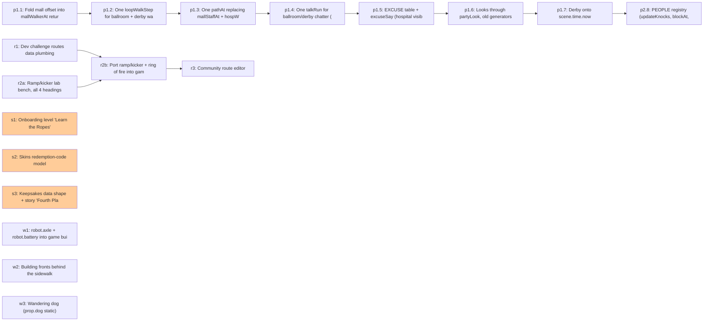

# Build queue (generated by tools/queue.py; edit build_queue.json)

Agents: run `python3 tools/queue.py next`, build it per CLAUDE.md, then
`python3 tools/queue.py done <id>`, commit, push to `consistency-pass`.

- [ ] `p1.1` Fold mall offset into mallWalkerAt return; drop m.oa/m.ob at 3 call sites
- [ ] `p1.2` One loopWalkStep for ballroom + derby walkers (identical positions)
- [ ] `p1.3` One pathAt replacing mallStaffAt + hospWalkerAt
- [ ] `p1.4` One talkRun for ballroom/derby chatter (visible change)
- [ ] `p1.5` EXCUSE table + excuseSay (hospital visible change)
- [ ] `p1.6` Looks through partyLook, old generators as aliases
- [ ] `p1.7` Derby onto scene.time.now
- [ ] `p2.8` PEOPLE registry (updateKnocks, blockAt, hospital walkers solid)
- [ ] `r1` Dev challenge routes data plumbing
- [ ] `r2a` Ramp/kicker lab bench, all 4 headings
- [ ] `r2b` Port ramp/kicker + ring of fire into game/index.html, debut in a challenge route
- [ ] `r3` Community route editor
- [!] `s1` Onboarding level 'Learn the Ropes' (needs hazard choice, menu label)
- [!] `s2` Skins redemption-code model (needs price, launch count, code format)
- [!] `s3` Keepsakes data shape + story 'Fourth Place' (needs save-across-devices, mission data)
- [ ] `w1` robot.axle + robot.battery into game build
- [ ] `w2` Building fronts behind the sidewalk
- [ ] `w3` Wandering dog (prop.dog static)
