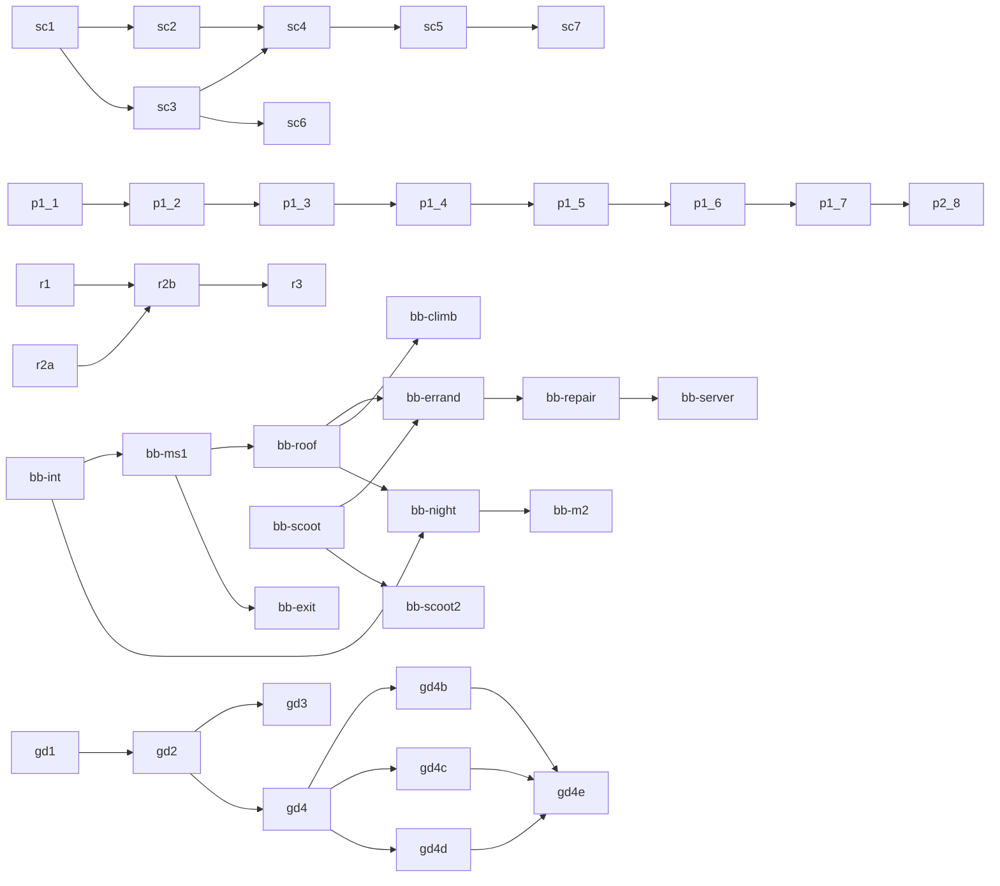

# Build plan (generated by tools/queue.py; edit build_queue.json)

Agents: run `python3 tools/queue.py next`, build it, then `python3 tools/queue.py done <id>`,
commit, push to `consistency-pass`. `[ ]` pending, `[?]` built, awaiting Sir's test, `[x]` signed off, `[!]` waiting on Sir, `[-]` dead (dropped).

## Dependencies

## People: seeded crowd
- [?] `sc1` World clock + slot scheduler + seeded shoppers (pilot) [docs/seeded-crowd.md]
- [?] `sc2` Seeded residents: houses, scooter trips, dog walkers [docs/seeded-crowd.md]
- [?] `sc3` Seeded seekers, errand drivers, food-truck customers [docs/seeded-crowd.md]
- [?] `sc4` Seeded strand, boardwalk, almshouse court and the other live populations [docs/seeded-crowd.md]
- [?] `sc5` Census: same seed, two boots, every CITY_PEOPLE group the same [docs/seeded-crowd.md]
- [?] `sc6` Seeded traffic: loop clocks on the world clock, hold only near him and decayed to zero out of sight, errand cars and food-truck sessions scheduled; loop offsets staggered so shared streets don't overlap [docs/seeded-crowd.md]
- [?] `sc7` Census leftovers onto the seed: the groups in tools/crowd_census_known.json stay on the known list (decided: left) [docs/seeded-crowd.md]

## People unification
- [?] `p1.1` Fold mall offset into mallWalkerAt return; drop m.oa/m.ob at 3 call sites [docs/people-unification.md#plan-by-risk]
- [?] `p1.2` One loopWalkStep for ballroom + derby walkers (identical positions) [docs/people-unification.md]
- [x] `p1.3` One pathAt replacing mallStaffAt + hospWalkerAt (skipped: the hospital walk is a racetrack loop, not a two-point ping-pong) [docs/people-unification.md]
- [?] `p1.4` One talkRun for ballroom/derby chatter (visible change) [docs/people-unification.md]
- [?] `p1.5` EXCUSE table + excuseSay (hospital visible change) [docs/people-unification.md]
- [x] `p1.6` Looks through partyLook, old generators as aliases (already done in the code: staffLook and mallJailLook are rosterBody aliases, storeRepLook and tixLooks build on it, the inline lookOf is mallJailLook) [docs/people-unification.md]
- [?] `p1.7` Derby onto scene.time.now [docs/people-unification.md]
- [?] `p2.8` PEOPLE registry (updateKnocks, blockAt, hospital walkers solid) [docs/people-unification.md]

## Roadmap: routes, ramps, editor
- [?] `r1` Dev challenge routes data plumbing [test](https://cal-starfur.github.io/Tipsy/consistency-pass/?route=tight-1) [docs/roadmap.md#phase-1]
- [?] `r2a` Ramp/kicker lab bench, all 4 headings [test](https://cal-starfur.github.io/Tipsy/consistency-pass/labs/ramp-jump.html) [docs/ramp-jump-spec.md]
- [?] `r2b` Port ramp/kicker + ring of fire into game/index.html, debut in a challenge route [test](https://cal-starfur.github.io/Tipsy/consistency-pass/?route=tight-1&go=10440,5720,0&view=2) [docs/ramp-jump-spec.md]
- [-] `r3` Community route editor [docs/roadmap.md#phase-3]

## Specs (waiting on decisions)
- [!] `s1` Onboarding level 'Learn the Ropes' (needs hazard choice, menu label) [docs/onboarding-spec.md]
- [!] `s2` Skins redemption-code model (needs price, launch count, code format) [docs/skins-spec.md]
- [!] `s3` Keepsakes data shape + story 'Fourth Place' (needs save-across-devices, mission data) [docs/keepsakes.md]
- [!] `s4` Museum story 'The Last Bone' (needs story, pickup place, reward) [docs/museum-mission.md]

## Consistency pass: doors
- [?] `d1` Working door: Seabreeze Ballroom (doorF records itself) [test](https://cal-starfur.github.io/Tipsy/consistency-pass/?go=26588,2812&view=3) [docs/state/CONSISTENCY_PASS.md#still-to-do]
- [?] `d2` Working door: Animal Shelter (painted door today) [test](https://cal-starfur.github.io/Tipsy/consistency-pass/?go=7860,8684&view=3) [docs/state/CONSISTENCY_PASS.md#still-to-do]
- [?] `d3` Working door: harbour boat cabin [docs/state/CONSISTENCY_PASS.md#still-to-do]
- [?] `d4` Working doors: Surfside Diner + Sandpiper Shoes [docs/state/CONSISTENCY_PASS.md#still-to-do]
- [?] `d5` Kai + surf stand door; Low Tide Music door faces away [test](https://cal-starfur.github.io/Tipsy/consistency-pass/?go=-4900,11450&view=2) [docs/state/CONSISTENCY_PASS.md#still-to-do]

## Consistency pass: buildings
- [ ] `b1` Tide Pool Elementary in pieces (U1k/U1c) [docs/state/CONSISTENCY_PASS.md#still-to-do]
- [ ] `b2` Palmline Tower key + vol, forecourt out of its one image [docs/state/CONSISTENCY_PASS.md#still-to-do]

## Consistency pass: vehicles
- [ ] `v1` One vehicleSolid(kind) for the ten parked-car boxes [docs/state/CONSISTENCY_PASS.md#still-to-do]
- [ ] `v2` Riders obstacle list + clearance [docs/state/CONSISTENCY_PASS.md#still-to-do]
- [ ] `v3` Parking rows cached, one bay size [docs/state/CONSISTENCY_PASS.md#still-to-do]
- [ ] `v4` Showroom cars on gameCar [docs/state/CONSISTENCY_PASS.md#still-to-do]
- [ ] `v5` Route car out of the far lane [docs/state/CONSISTENCY_PASS.md#still-to-do]

## Consistency pass: people
- [ ] `pe1` Legs driven by distance walked (47 walkSin calls) [docs/state/CONSISTENCY_PASS.md#still-to-do]
- [ ] `pe2` Unlisted populations into CITY_PEOPLE (knockable batch: Sierra guard made knockable; duplicate food-truck entry removed; the rest were already listed (docs stale). Marisol/cook, hospital errand/jail/rescue: mission timelines, left) [docs/state/CONSISTENCY_PASS.md#still-to-do]
- [?] `pe3` Merge the two meet-spot pickers; meetCoverAt beyond street + mall (meetSide: one side chooser (lhSide/ohSide/kwSide/rlSide, tix, lost item); meetSpot was already the one picker; meetCoverAt in other interiors left) [docs/state/CONSISTENCY_PASS.md#still-to-do]
- [?] `pe4` Forno cook counter post; R6 on Tipsey himself (cook post and R6 on Tipsey (carried item on his lid) built) [docs/state/CONSISTENCY_PASS.md#still-to-do]

## Consistency pass: props
- [ ] `pr1` Prop collision taken from the art (lamp, hydrant, palm, bin, bench) [docs/state/CONSISTENCY_PASS.md#still-to-do]
- [ ] `pr2` Keep-clear of doors and mats [docs/state/CONSISTENCY_PASS.md#still-to-do]
- [ ] `pr3` Static prop shadows [docs/state/CONSISTENCY_PASS.md#still-to-do]
- [ ] `pr4` Pier + harbour still props cached [docs/state/CONSISTENCY_PASS.md#still-to-do]

## Walk-in landmarks
- [ ] `wk1` Dune Home & Garden [docs/state/walkin_recipe.md]
- [ ] `wk2` Saltwater Brewing [docs/state/walkin_recipe.md]
- [ ] `wk3` Lagoon Baths [docs/state/walkin_recipe.md]
- [ ] `wk4` Driftwood Chapel [docs/state/walkin_recipe.md]
- [ ] `wk5` Palmline Nursery [docs/state/walkin_recipe.md]
- [?] `wk6` Animal Shelter interior [test](https://cal-starfur.github.io/Tipsy/consistency-pass/?go=7820,8444&view=3) [docs/state/walkin_recipe.md]
- [ ] `wk7` Lagoon Market Hall [docs/state/walkin_recipe.md]
- [ ] `wk8` Ferris Taylor Cottages [docs/state/walkin_recipe.md]
- [ ] `wk9` Cove Grove [docs/state/walkin_recipe.md]
- [ ] `wk10` Airfield terminal [docs/state/walkin_recipe.md]

## Fleet and missions
- [ ] `f2` Fleet P2: rotor flight + The Lighthouse Run [docs/state/HANDOFF.md]
- [ ] `m1` Trophies alley fence to 0.3 over the room [docs/state/HANDOFF.md]
- [ ] `m2` Open House: crosswalk for the captain, live fire on the burn prop [docs/state/HANDOFF.md]
- [ ] `m3` KTDE: DJ side missions over the air; station van drives off [docs/state/HANDOFF.md]
- [ ] `m4` Letters on the Hill: face wash under roof edges; ranger inside her kiosk [docs/state/HANDOFF.md]

## Needs Sir
- [!] `x1` Fleet lock flip; garage shows big vehicle on pick; pier access for Flats players (decision) [docs/state/HANDOFF.md]
- [!] `x2` Region index follows the lock; Mirador developer; pier lamp + palm sizes (decision) [docs/state/HANDOFF.md]

## Flats dead space
- [!] `da8` Flats dead-space area 8 (details only in the v3 report artifact; needs a look) (confirm what area 8 is) [docs/state/HANDOFF.md]
- [!] `da9` Flats dead-space areas 9 + 12 (moved beyond the Flats) (waiting on region decision) [docs/state/HANDOFF.md]
- [!] `da13` Sunset Pier, area 13 (an edge of University) (waits on University hood lock) [docs/state/HANDOFF.md]

## Built, awaiting your test
- [?] `t-motel` Sun Deck Motor Lodge + The Getaway [docs/state/CONSISTENCY_PASS.md]
- [?] `t-kart` Tidewater Kart Works + Number 4 Builds a Winner [docs/state/CONSISTENCY_PASS.md]
- [?] `t-fish` Pelican Fish Market + Catch of the Day [docs/state/CONSISTENCY_PASS.md]
- [?] `t-paw` Paw Point Dog Park + Adoption Day [docs/state/CONSISTENCY_PASS.md]
- [?] `t-vet` Veterans Memorial + Sunset Salute [docs/state/CONSISTENCY_PASS.md]
- [?] `t-surf` Sunset Shore Surf School + Sunset Session [docs/state/CONSISTENCY_PASS.md]
- [?] `t-watch` Vista Ridge Security Post + Night Watch [docs/state/CONSISTENCY_PASS.md]
- [?] `t-ktde` KTDE 98.1 The Tide, whole block + Request Line [docs/state/CONSISTENCY_PASS.md]
- [?] `t-fire` Fire Training Yard + Open House [docs/state/CONSISTENCY_PASS.md]
- [?] `t-letters` Letters on the Hill [docs/state/CONSISTENCY_PASS.md]
- [?] `t-skate` Driftwood Skate Park [test](https://cal-starfur.github.io/Tipsy/consistency-pass/?go=17204,21060,-1.57&view=3) [docs/state/CONSISTENCY_PASS.md]
- [?] `t-museum` Tidewater Museum (no drive, dimmer lanterns) [test](https://cal-starfur.github.io/Tipsy/consistency-pass/?go=10948,2700,0.73&view=3) [docs/state/CONSISTENCY_PASS.md]
- [?] `t-trophies` Seabreeze Trophies + Pelican Drug walk-ins [docs/state/CONSISTENCY_PASS.md]
- [?] `t-rules` Shared rules: one door rule, meet walk, crew pace, no fades, order/solids/cache [test](https://cal-starfur.github.io/Tipsy/consistency-pass/?go=shops&view=2) [docs/state/CONSISTENCY_PASS.md]

## Fixes from testing
- [x] `museum-footprint` Maritime Museum: red footprint (LAB 1460x856) covers only the front ~55% of the shell's depth; inside photo shows the whole building. Red also sits ~25px (~35 units) out in front of the long face wall base. Needs a decision: make LAB the full shell or confirm the rear is not a room [test](https://cal-starfur.github.io/Tipsy/consistency-pass/?go=10948,1688&view=3) [found by test run]
- [?] `vista-footprint` Vista Ridge Security Post: red footprint ends ~45px (~55 units) short of the shell's east wall; rest matches [test](https://cal-starfur.github.io/Tipsy/consistency-pass/?go=9090,-6090&view=2) [found by test run]
- [?] `trophies-footprint` Seabreeze Trophies: red footprint sits ~25-30px (~35 units) forward of the shell wall base on the west end; size matches (760x600). Right/gate side hidden, not judged [test](https://cal-starfur.github.io/Tipsy/consistency-pass/?go=4274,14974&view=2) [found by test run]
- [?] `pelican-walltop` Pelican room walls H 232 vs shell cornice 348 world (232 kit x ZSCALE 1.5): set PELICAN_IN H 348 [test](https://cal-starfur.github.io/Tipsy/consistency-pass/?go=20141,14064&view=2) [found by test run]
- [?] `kart-yard` Kart Works yard: the block's bare brown-checker centre becomes the club's practice loop with cones, tyre barriers, start gantry, pit canopy and benches [test](https://cal-starfur.github.io/Tipsy/consistency-pass/?go=4204,13628&view=2) [found by test run]
- [?] `kart-yard-fence` Kart Works block: the open frontages fenced in the alley gate's iron (north, west, east between barn and depot) [test](https://cal-starfur.github.io/Tipsy/consistency-pass/?go=4692,14076&view=3) [found by test run]
- [?] `kart-works-shell` Tidewater Kart Works: shell was smaller than its room's outer walls; widened to 820 x 680, east frontage becomes an alley gate [test](https://cal-starfur.github.io/Tipsy/consistency-pass/?go=5630,13658&view=3) [found by test run]
- [x] `fleet-apron` Marina Parking: pale flat paving rectangle left of the garage entry reads lighter than neighbouring slabs, and the asphalt apron ends in a diagonal flat cut against the paving (wide photo, left of ENTER sign). May be intentional; needs Sir's eye. [test](https://cal-starfur.github.io/Tipsy/consistency-pass/?go=1600,21300&view=3) [found by test run]
- [?] `skate-sign` Driftwood Skate Park street sign: board keyed at its middle, so fence pieces to its right painted over the text ('DRIFTWOO' cut off); keyed at its right end now [test](https://cal-starfur.github.io/Tipsy/consistency-pass/?go=17510,21142&view=2) [found by test run]
- [?] `skate-lamps` Flood pole lamp heads read as tan cardboard boxes at night (shared queueLandmarkLamps glow, also on other landmarks); needs a decision/art from Sir [test](https://cal-starfur.github.io/Tipsy/consistency-pass/?go=17204,21060&view=3) [found by test run]
- [?] `port-fanlight` Port Office fanlight/window arch drawn as full ellipse: lower half painted over door glass and upper half over the PORT OFFICE sign [test](https://cal-starfur.github.io/Tipsy/consistency-pass/?go=-3500,-13800&view=2) [found by test run]

## Brew & Bolt: Minding the Shop
- [?] `bb-ext` Exterior character: copper-and-cream brick plinth, frieze, goosenecks, corner blade, rooftop cups; the east flank matches the front (shopfront band, awnings, glass, cornice) [test](https://cal-starfur.github.io/Tipsy/consistency-pass/?go=4700,15500&view=3) [docs/kits/missions.md]
- [?] `bb-int` Interior: service counter (espresso machine, pastry case, till, stools), back bar, brick dado, neon bolt and Gideon mural, rugs, robot charging nook; Gideon is the game's own humanoid; planters kept off the footprint [test](https://cal-starfur.github.io/Tipsy/consistency-pass/?go=460418,430450&view=2) [docs/kits/missions.md]
- [?] `bb-ms1` Mission opens: Brew & Bolt's mat is the mission's (robot-head icon, no ordinary orders); Gideon comes out and asks; Not now works; the player becomes Gideon (humanoid loan); Tipsey rolls in and works the counter (NIGHT_CLOCK.time = 11) [test](https://cal-starfur.github.io/Tipsy/consistency-pass/?go=5102,15097&view=2) [docs/kits/missions.md]
- [?] `bb-scoot` The humanoid can hop on any city scooter (Hop on / Hop off button) and ride it (needs the humanoid: start the mission, or FLEET_LOAN = 'humanoid') [test](https://cal-starfur.github.io/Tipsy/consistency-pass/?go=9000,9000&view=2) [docs/kits/missions.md]
- [?] `bb-roof` The roof: the back room's ladder and hatch, a second room on the same square above the shop (Brew & Bolt Roof), bent antenna mast, the inspection card, back down the hatch [test](https://cal-starfur.github.io/Tipsy/consistency-pass/?go=470300,430250&view=2) [docs/kits/missions.md]
- [?] `bb-errand` The parts errand: Gideon rides a scooter to Breakwater Hardware (about 33,000 road units, 6.5 min by GPS: consider a nearer parts shop), the clerk hands over a mast bracket and a coax connector (carried item), beacon and GPS there and back [test](https://cal-starfur.github.io/Tipsy/consistency-pass/?go=5102,15097&view=2) [docs/kits/missions.md]
- [?] `bb-repair` The repair and finish: back up the ladder, the mast straightened and the cable fixed, the order screen lights, Gideon's thanks, one completion card [test](https://cal-starfur.github.io/Tipsy/consistency-pass/?go=5102,15097&view=2) [docs/kits/missions.md]
- [?] `bb-server` Mission records: TS_MISSIONS 'minding-the-shop' (tipsey-delivery/src/server/tpcatalog.ts), reward ids (db.ts), trophy and skin entries if any, MISSIONS reward, mission-board listing and place-card text, missions.md row and seed line. Reward decided (Sir): Gideon playable, the humanoid's fleet unlock; no trophy, skin or cash [test](https://cal-starfur.github.io/Tipsy/consistency-pass/?go=5102,15097&view=2) [docs/kits/missions.md]
- [?] `bb-exit` Replace the temporary 'parts' bay that hands the shop back: Tipsey leaves the counter and the loan ends where Gideon finishes; abort and quit paths (leave mid-mission, tip over, reload) keep nothing half-done [test](https://cal-starfur.github.io/Tipsy/consistency-pass/?go=5102,15097&view=2) [docs/kits/missions.md]
- [?] `bb-climb` Climb polish: the ladder art stretched to the real 343 climb, the hatch opens visibly from inside, a walked climb instead of the dissolve, roof collisions (parapet, mast, vent, hatch curb) checked by walking [test](https://cal-starfur.github.io/Tipsy/consistency-pass/?go=470300,430250&view=2) [docs/kits/missions.md]
- [?] `bb-scoot2` Scooter polish: tune top speed and turning, gate pedestrian knocks and police while riding, dismount rules (doors, loans ending), scooters set down stay put on reload [test](https://cal-starfur.github.io/Tipsy/consistency-pass/?go=9000,9000&view=2) [docs/kits/missions.md]
- [?] `bb-night` Night pass: the interior's neon bolt and counter, the exterior lamps, the roof, the robot-head beacon after dark (NIGHT_CLOCK.time = 22) [test](https://cal-starfur.github.io/Tipsy/consistency-pass/?go=5102,15097&view=2&night=1) [docs/kits/missions.md]
- [!] `bb-m2` Second Gideon / Brew & Bolt mission (story, giver, place, reward and window still to decide with Sir; Gideon is playable now, the shop and roof are built) (needs the story) [docs/kits/missions.md]

## Parked (waiting on Sir)
- [ ] `fleet-spots` Fleet test spots (Marina Parking bays 1600,21300; fuel farm hall 26280,26800; harbour boathouse -5500,-12150) frame a garage ramp, fuel tanks and a yacht, not fleet bays; no bay doors/pads/big-vehicle bays visible in any photo, so item 1-2 could not be judged. Needs Sir to give the real bay coordinates. [test](https://cal-starfur.github.io/Tipsy/consistency-pass/?go=1600,21300&view=2) [found by test run]
- [ ] `fleet-spots` Spots now point at the real hall centres from FLEET_HALL_DEFS (F3 1020/2226,21031; F4 26280,26588; F2b -5500,-12546; F7h 27990,20420), but no bays draw anywhere because FLEET_BAYS_BUILT=false (game/index.html:5191) switches all fleet halls off. Needs Sir: flip it on (re-test) or leave the bays out. [test](https://cal-starfur.github.io/Tipsy/consistency-pass/?go=26280,26588&view=2) [found by test run]

## Gideon's pad
- [?] `gd1` Gideon's charging pad in the back room (the same round pad as Tipsey's; the roaster stays) [test](https://cal-starfur.github.io/Tipsy/consistency-pass/?go=460124,430266&view=2) [docs/gideon-dock.md]
- [?] `gd2` Choosing the humanoid in the fleet starts you as Gideon on his pad in the back room (not Tipsey's station) [test](https://cal-starfur.github.io/Tipsy/consistency-pass/?view=2) [docs/gideon-dock.md]
- [?] `gd3` The pad charges him: its glow breathes, battery fills on it (and, as ever, at any of Tipsey's charging stations) [test](https://cal-starfur.github.io/Tipsy/consistency-pass/?view=2) [docs/gideon-dock.md]
- [?] `gd4` Customise Gideon, tranche 1: his own garage tabs (Shell, Face, Band & pack, Feet) from his pad, 16 shells, colour wheels, 6 eye shapes, 7 mouths, bands, pack, joints, hands, 4 shoe kinds; kept in the profile and drawn on him everywhere [test](https://cal-starfur.github.io/Tipsy/consistency-pass/?view=2) [docs/gideon-dock.md]
- [?] `gd4b` Gideon's Head tab: 12 headwear styles (flat cap, beanie, bowler, top hat, chef's hat, headphones, antenna, twin antennas, visor, party hat, crown, propeller cap) in any colour, on Tipsey's paint system [test](https://cal-starfur.github.io/Tipsy/consistency-pass/?view=2) [docs/gideon-dock.md]
- [?] `gd4c` Gideon's Outfit tab: apron, vest, scarf, bow tie, tie, 5 badges, 5 glasses, and 5 pack styles (Band & pack tab), each in any colour, on Tipsey's paint system [test](https://cal-starfur.github.io/Tipsy/consistency-pass/?view=2) [docs/gideon-dock.md]
- [?] `gd4d` Gideon's Finish and Decals tabs: satin, matte, gloss, chrome, two-tone (second colour on the legs); racing stripes, chevron, star, bolt, heart, race numbers 1/4/7/9 in any colour [test](https://cal-starfur.github.io/Tipsy/consistency-pass/?view=2) [docs/gideon-dock.md]
- [?] `gd4e` Gideon's Looks tab: 10 ready-made looks (Stock, Barista, Night Shift, Chrome, Workshop, Sunset, Racer, Chef, Royal, Party), tried on whole and added to the cart together at the parts' prices [test](https://cal-starfur.github.io/Tipsy/consistency-pass/?view=2) [docs/gideon-dock.md]
